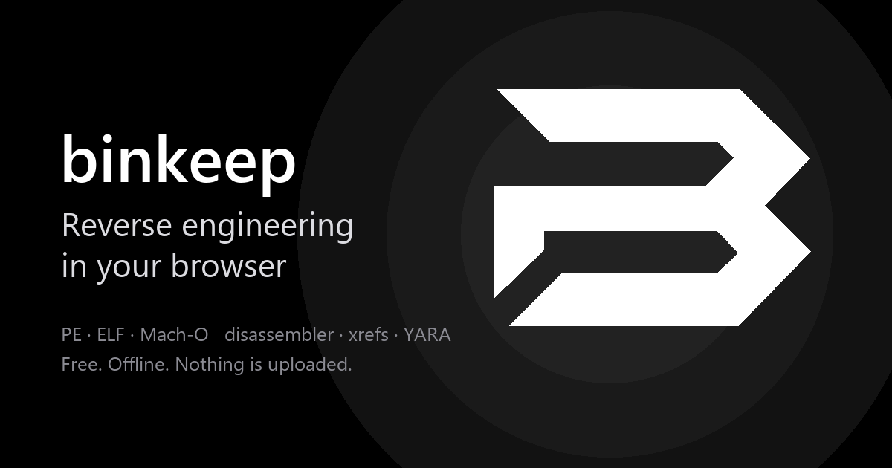
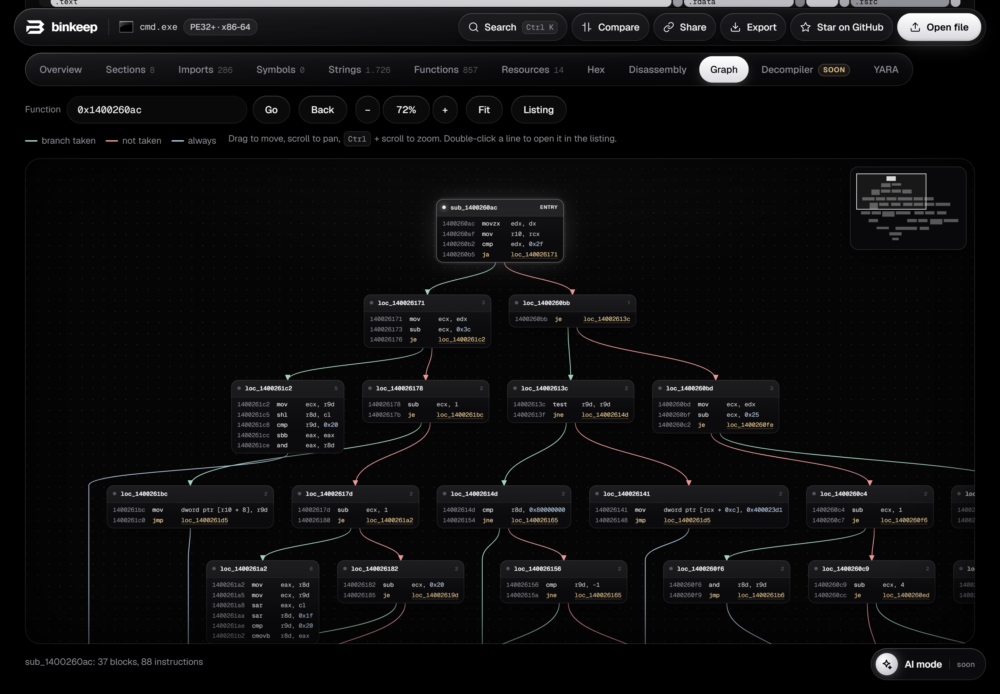
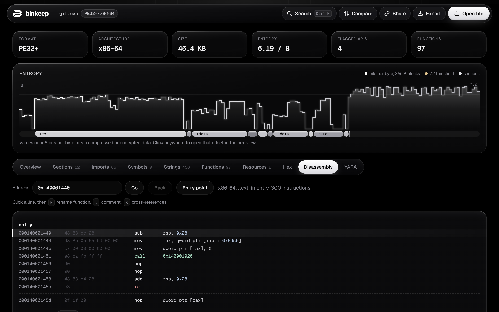

**Reverse engineering in your browser.** Drop an executable, get a first look in seconds. binkeep is a free, open source binary analysis tool for PE, ELF, Mach-O, .NET and Android apps: disassembler, functions, cross-references, strings, imports, YARA, packer detection, and a list of what the file can do mapped to MITRE ATT&CK. The file is never uploaded, and after the first visit it works offline.

**Try it: https://kano92-dir.github.io/binkeep/**

[](https://kano92-dir.github.io/binkeep/)

It is not a Ghidra replacement. It covers the first part of looking at an unknown binary, without installing anything: malware triage, CTF challenges, checking what a downloaded tool imports, or comparing two builds.





## Features

**Formats**
- PE32 / PE32+ (Windows), ELF32 / ELF64 (Linux, either endianness), Mach-O 32/64 and universal binaries (macOS, iOS)
- .NET assemblies: types and methods, referenced assemblies, the framework calls the code makes, P/Invoke imports, embedded resources and user strings, plus obfuscator detection
- Android APK and DEX: manifest (package, SDK levels, permissions, exported components, debuggable, cleartext traffic), classes and packages, risky API references, signing scheme (v1, v2/v3, debug key), and the native libraries inside, each one openable on its own
- ZIP archives, including password-protected ones (ZipCrypto and AES). The usual sample passwords such as `infected` are tried first
- Anything else still gets hex, strings, entropy and YARA

**Overview**
- What it can do: behaviours such as logging keys, taking screenshots, starting at boot, injecting into other processes, downloading files or reading SMS, found from imports, strings, .NET calls and Android permissions, each mapped to a MITRE ATT&CK technique with the evidence
- Hash lookups: open the file's SHA-256 on VirusTotal, MalwareBazaar or Hybrid Analysis with one click (only the hash is sent, and only when you click)
- Headers, entry point, compile time, linked libraries, platform and SDK versions
- Security mitigations: ASLR, DEP, CFG (PE); PIE, NX, RELRO, canary, FORTIFY (ELF); PIE, canary, ARC, hardened runtime (Mach-O)
- Packer detection: UPX, Themida, VMProtect, ASPack, MPRESS, PECompact, Enigma, .NET obfuscators and more, by section names and byte signatures, plus heuristics (code entropy, import count, entry point placement)
- Authenticode: signer, issuer, validity, timestamp, and the file digest recomputed to show whether the file changed after signing
- Mach-O code signature: identifier, team ID, ad-hoc or developer, hardened runtime
- Toolchain hints: Go, Rust, Nim, PyInstaller, NSIS, Inno Setup, AutoIt, Electron, .NET, GCC

**Code**
- Function list from a full linear sweep of the code, plus `.pdata` (x64 PE) and `LC_FUNCTION_STARTS` (Mach-O)
- Cross-references: who calls a function, which code uses an import, which code reads a string
- Disassembly (x86, x64, ARM, ARM64 via Capstone in WebAssembly) with API names through the IAT, GOT and Mach-O stubs, inline strings, clickable branches
- Jump to main: skips the compiler's startup code and opens the program's own `main` (MSVC and MinGW startup, glibc `__libc_start_main`, Mach-O `LC_MAIN`, Go `main.main` even when stripped), or press `M`
- Control flow graph for any function: basic blocks with taken / not taken / loop edges, pan and zoom, `Space` to switch between the listing and the graph
- Your own function names and comments (`N`, `;`, `X` in the disassembly), saved in the browser per file hash

**Data**
- Entropy graph with section bands, sections with R/W/X flags
- Imports with heuristic tags (injection, anti-debug, network, crypto, persistence, ...) and call counts
- Strings (ASCII and UTF-16) with regex filter, categories, and a "referenced by code" filter
- PE resources: version info, manifest (requested execution level), the application icon, and embedded executables or archives
- Hex view that stays fast on large files

**Workflow**
- YARA: real libyara compiled to WebAssembly, with the `pe`, `elf` and `math` modules. Your rules are kept in the browser and run on every file you open
- Compare two files: changed headers, sections, imports, exports and strings
- Share link: the report is compressed into the URL fragment (`#r=...`), which browsers never send to a server. The file itself is never included
- Export the report as Markdown or JSON
- Command palette (`Ctrl+K` / `Cmd+K`): jump to any function, import, symbol, string, address or action
- Installable as an app, works offline. On Android, the installed app shows up in the share menu, so you can send a downloaded file straight to binkeep

## Host it yourself

It is a static site with no build step. GitHub Pages works as is: push the repository, then in Settings > Pages pick the `main` branch and the root folder.

## Run locally

```
python serve.py
```

Then open http://localhost:8765. Any static file server works, as long as it serves `.js` as `text/javascript` and `.wasm` as `application/wasm`.

No build step. Capstone (capstone-wasm 1.0.3) and libyara (libyara-wasm 1.2.1) are bundled in `vendor/`.

## Privacy

All analysis happens in the page. The only network requests are the app files and Google Fonts. The share link carries the report, not the file, and the part after `#` is never sent to any server.

## Limits

- Function discovery is a linear sweep: data inside code can be misread, and functions that are only reached through pointers may be missed
- The Authenticode certificate chain is not verified, only the file digest
- No decompiler yet (planned)
- API tags are hints. Legitimate software uses every one of those APIs

## License

binkeep is MIT licensed, see [LICENSE](LICENSE).

Bundled third-party code, with license texts next to it in `vendor/`:
- [Capstone](https://www.capstone-engine.org) (BSD), via the [capstone-wasm](https://github.com/CzBiX/disasm-web) 1.0.3 build
- [libyara-wasm](https://github.com/artemisbot/libyara-wasm) 1.2.1 (ISC)
- [YARA](https://github.com/VirusTotal/yara) (BSD-3-Clause)
